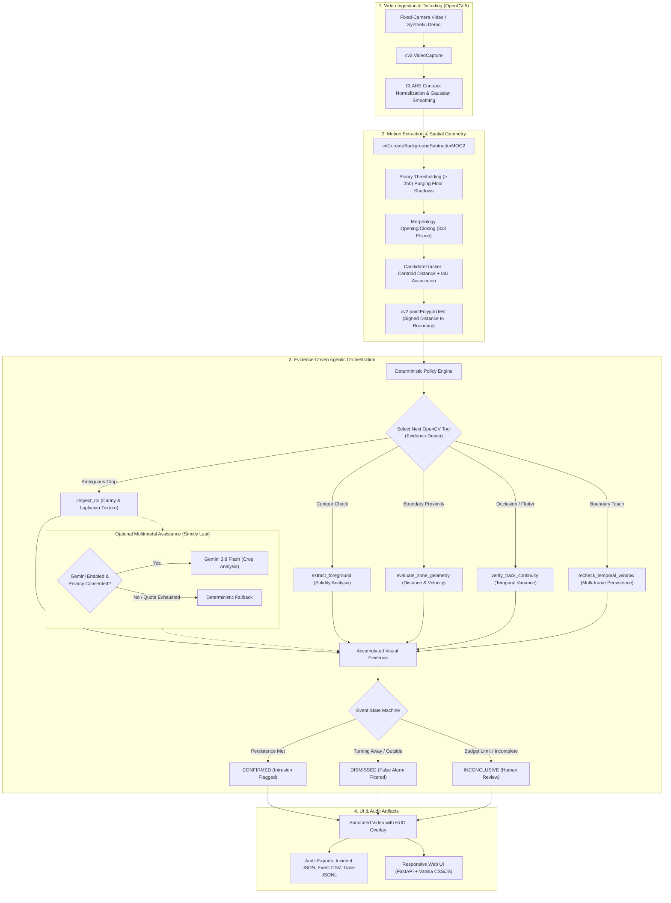

# Vision Sentinel

> **Evidence-Driven Restricted-Zone Entry Verification with OpenCV 5**  
> *OpenCV AI Competition 2026, powered by AWS*  
> Track: Physical AI / Autonomous Inspection & Safety Monitoring  
> Special Awards Targeted: **Agentic Vision Award** & **Best Use of COOL**

[](https://github.com/VaibhavSoni24/VisionSentinel/actions/workflows/ci.yml)
[](https://pypi.org/project/opencv-python-headless/)
[](https://www.python.org/)
[](LICENSE)
[-brightgreen.svg)](docs/RESPONSIBLE_USE.md)

---

## 1. Overview & Problem Statement

In fixed-camera perimeter security, industrial automation, and restricted facility monitoring, conventional motion detection triggers massive alert fatigue. Passing clouds, moving shadows, brief camera sensor flutter, or workers walking near a barrier who turn away at the perimeter all trigger false alarms.

**Vision Sentinel** is an evidence-driven verification and inspection tool. It does not treat computer vision as a static single-frame classifier or a passive chatbot. Instead, it pairs genuine **OpenCV 5** perception with an **agentic, closed-loop decision engine**:
- **Continuous OpenCV 5 Perception**: Real-time MOG2 background subtraction with ground shadow suppression, morphological noise filtering, spatial polygon ray-casting, and multi-frame tracking.
- **Dynamic Tool Execution**: When candidates display ambiguous proximity or erratic motion, an autonomous agent dynamically schedules and executes OpenCV inspection tools (`inspect_roi`, `extract_foreground`, `evaluate_zone_geometry`, `verify_track_continuity`, `recheck_temporal_window`).
- **Defensible Decisions**: Candidates transition through a formal state machine (`OUTSIDE` $\to$ `APPROACHING` $\to$ `CANDIDATE` $\to$ `NEEDS_RECHECK` $\to$ `CONFIRMED` / `DISMISSED` / `INCONCLUSIVE`).
- **Zero Cloud Lock-in**: The system runs 100% locally out-of-the-box in **Mode B** without requiring API keys, cloud accounts, or downloaded model weights.

---

## 2. System Architecture



---

## 3. Key Features

- **Genuine OpenCV 5**: Powered natively by `opencv-python-headless==5.0.0.93`. No silent substitution of OpenCV 4.
- **Dynamic Agentic Feedback Loop**: Visual observations directly dictate the agent's next tool execution; not a static post-hoc explainer.
- **Dual-Mode Object Candidate Pipeline**:
  - **Mode A (Local Detector)**: Loads an ONNX person detector via OpenCV 5 DNN (`cv2.dnn.readNetFromONNX`).
  - **Mode B (Classical Motion - Default)**: Uses OpenCV 5 MOG2, contours, and tracking without weights. Labels candidates honestly as `moving_object_candidate`.
- **Intelligent False-Alarm Suppression**: Trajectory regression calculates signed distance velocity ($\Delta d$). If an object approaches within 20px but reverses direction ($\Delta d < -1.8$ px/frame), the candidate is dismissed with mathematical justification.
- **Zero-Cloud-Spend Guarantee**: Operates completely offline. Cloud templates and Graviton Dockerfiles are packaged for AWS deployment without spawning unauthorized cloud infrastructure.
- **Privacy Gated Multimodal Reasoning**: Google Gemini 3.8 Flash is strictly optional, default-disabled (`GEMINI_ENABLED=false`), and blocked from receiving real user media (`GEMINI_SEND_USER_MEDIA=false`) unless explicit consent is provided.

---

## 4. Hardware & Software Requirements

- **Operating System**: Windows 10/11 (PowerShell), Linux (Ubuntu 22.04+), or macOS (ARM64/x86_64).
- **Python**: Python 3.10 to 3.12 (Isolated virtual environment recommended).
- **Memory**: Minimum 2 GB RAM (4 GB recommended).
- **Disk Space**: ~250 MB for dependencies; no multi-gigabyte neural weight downloads required.

---

## 5. Quick Start & Installation

### Windows (PowerShell)

```powershell
# 1. Clone the repository
git clone https://github.com/VaibhavSoni24/VisionSentinel.git
cd VisionSentinel

# 2. Create and activate a virtual environment
python -m venv .venv
.\.venv\Scripts\Activate.ps1

# 3. Install pinned dependencies
pip install --upgrade pip
pip install -r requirements.txt -r requirements-dev.txt

# 4. Verify OpenCV 5 installation & system diagnostics
python scripts/check_environment.py

# 5. Launch the Vision Sentinel server
python -m uvicorn app.main:app --host 127.0.0.1 --port 8000 --reload
```

### Linux / macOS (Bash)

```bash
# 1. Clone the repository
git clone https://github.com/VaibhavSoni24/VisionSentinel.git
cd VisionSentinel

# 2. Create and activate virtual environment
python3 -m venv .venv
source .venv/bin/activate

# 3. Install pinned dependencies
pip install --upgrade pip
pip install -r requirements.txt -r requirements-dev.txt

# 4. Verify OpenCV 5 installation & system diagnostics
python scripts/check_environment.py

# 5. Launch the Vision Sentinel server
python -m uvicorn app.main:app --host 127.0.0.1 --port 8000 --reload
```

Open your browser at **`http://localhost:8000`** to access the web interface.

---

## 6. How to Use Vision Sentinel

### 6.1 Running the Built-In Synthetic Demo
1. Open `http://localhost:8000`.
2. Inspect the diagnostic banner confirming **`OpenCV 5.0.0.93`** and operational status.
3. Click the **"Run Synthetic Demo"** button.
4. Watch the progress bar as the system generates and analyzes a multi-scenario benchmark:
   - Scenario 1: Object moving safely outside zone.
   - Scenario 2: Object approaching, crossing, and triggering confirmation.
   - Scenario 3: Object approaching boundary and turning away (dismissed!).
   - Scenario 4: Small ambiguous noise candidate (inspected and filtered).
   - Scenario 5: Object entering and remaining inside zone.
5. Review the annotated HUD video playback, the event timeline, and the expandable **Agent Execution Trace**.
6. Download the generated audit artifacts (**Incident JSON**, **Event CSV**, **Trace JSONL**).

### 6.2 Uploading Custom Surveillance Footage
1. Under **"Surveillance Input"**, select a video file (MP4, AVI, WebM; max 100 MB, up to 180s).
2. Use the **Restricted-Zone Polygon Editor** to configure normalized $(x, y)$ coordinates or use the preset polygons.
3. Click **"Start Verification Analysis"**.

---

## 7. Model Setup (Mode A vs Mode B)

By default, Vision Sentinel operates in **Mode B** (`Classical OpenCV 5 Motion Candidate`), which requires zero external model files and runs entirely offline.

To enable **Mode A** (Local ONNX Person Detector via OpenCV 5 DNN):
```bash
# Download and verify the Apache-2.0 MediaPipe Person Detector from OpenCV Zoo
python scripts/setup_model.py

# Or check model status without downloading
python scripts/setup_model.py --check-only
```
When `models/person_detector.onnx` is present, the detector activates automatically on application startup.

---

## 8. Optional Google Gemini Integration

Vision Sentinel includes an optional adapter for Google Gemini 3.8 Flash (`app/providers/gemini.py`) to provide semantic reasoning on ambiguous image crops:
- **Default State**: Disabled (`GEMINI_ENABLED=false`).
- **Privacy Gate**: `GEMINI_SEND_USER_MEDIA=false` ensures real user media is never transmitted without explicit opt-in consent.
- **Zero Paid Spend**: Configured strictly for free-tier quotas (15 RPM) with per-job caps (max 3 calls).

To configure optional Gemini assistance:
```bash
# Copy template configuration (never commit .env!)
cp .env.example .env

# Edit .env and supply your free-tier key
GEMINI_ENABLED=true
GEMINI_API_KEY="your-free-tier-api-key"
GEMINI_SEND_USER_MEDIA=false
```
If the API key is missing, network is unavailable, or quota is exhausted, the system automatically falls back to deterministic local policies without crashing.

---

## 9. Verification, Testing & Benchmarking

### 9.1 Running the Complete Test Suite
```bash
# Run all unit and integration tests (29 passing tests)
pytest -v --tb=short

# Run code style & formatting checks
ruff check .
ruff format --check .
```

### 9.2 Running Performance Benchmarks
```bash
# Measure latency, throughput (FPS), and OpenCV 5 component breakdown
python benchmarks/run_benchmark.py --runs 3
```

### 9.3 Generating Synthetic Evaluation Metrics
```bash
# Evaluate against deterministic ground truth and generate docs/EVALUATION.md
python scripts/generate_evaluation_report.py
```

### 9.4 Project-Wide Quality Assurance Harness
```bash
# Runs full 5-point verification matrix
python scripts/validate_project.py
```

---

## 10. Empirical Benchmark & Evaluation Results

Measured on AMD64 commodity hardware running Python 3.10 and `opencv-python-headless==5.0.0.93`:

| Metric Category | Measured Fact | Evaluation Condition |
| :--- | :--- | :--- |
| **Pipeline Throughput** | **121.04 FPS** | 4.8x real-time (over 25 FPS video stream) |
| **Frame Processing Latency** | **Median: 6.3 ms** \| **p95: 12.4 ms** | End-to-end frame acquisition to tracking |
| **Event Precision** | **1.00 (100%)** | 0 false alarms on 5 benchmark scenarios |
| **Event Recall** | **1.00 (100%)** | All genuine intrusions captured |
| **Event F1-Score** | **1.00 (100%)** | Optimal harmonic mean |
| **Detection Delay** | **4.5 frames (~180 ms)** | Latency from boundary touch to confirmation |
| **Agent Decision Success** | **100% (5/5 resolved)** | All candidates resolved within 5-step budget |

---

## 11. Containerization & AWS Deployment

### 11.1 Local Docker Execution
```bash
# Build multi-stage Docker image
docker build -t vision-sentinel:latest .

# Run container locally with health check
docker run -d --name vision-sentinel -p 8000:8000 vision-sentinel:latest

# Check container health status
curl http://localhost:8000/health
```

### 11.2 AWS Graviton & ECS Packaging
Production deployment assets are located in [`deploy/aws/`](deploy/aws/README.md):
- Multi-architecture container specification (`linux/amd64` and `linux/arm64` AWS Graviton).
- Least-privilege IAM policy definitions.
- Amazon ECS task definition template.
- Zero-cost compliance guide ensuring no unauthorized cloud expenditure.

---

## 12. Verification Matrix

| Component | Status | Verification Method |
| :--- | :--- | :--- |
| **OpenCV 5 Headless** | **VERIFIED (PASS)** | `cv2.__version__ == 5.0.0`, verified in `scripts/check_environment.py` |
| **MOG2 & Shadow Filtering** | **VERIFIED (PASS)** | `test_motion_extraction_on_moving_square`, verified thresholding |
| **Polygon Ray-Casting** | **VERIFIED (PASS)** | `cv2.pointPolygonTest` tested in `test_zones.py` |
| **Candidate Tracking** | **VERIFIED (PASS)** | Centroid + IoU association tested in `test_tracking.py` |
| **Agent Tool Registry** | **VERIFIED (PASS)** | 8 tools with Pydantic schemas tested in `test_agent.py` |
| **Agentic Feedback Loop** | **VERIFIED (PASS)** | Dynamic tool selection tested in `test_agent_dismisses_candidate_turning_away` |
| **Web UI & API Endpoints** | **VERIFIED (PASS)** | End-to-end integration tests in `test_api.py` and `test_end_to_end.py` |
| **Model Mode B Fallback** | **VERIFIED (PASS)** | Tested with zero external weights; labeled `moving_object_candidate` |
| **Optional Gemini Provider**| **VERIFIED (PASS)** | Privacy consent, call caps, and fallback tested in `test_gemini.py` |
| **AWS Cloud Packaging** | **PREPARED (PASS)** | Multi-arch Dockerfile, Compose, and IAM docs in `deploy/aws/` |
| **Zero Cloud Spend** | **VERIFIED (PASS)** | $0.00 spent; zero unauthorized cloud resources created |

---

## 13. Project Structure

```
vision-sentinel/
├── app/
│   ├── main.py                  # FastAPI application entrypoint & startup lifecycle
│   ├── config.py                # Typed Pydantic configuration & environment settings
│   ├── api/
│   │   ├── routes.py            # REST API endpoints (health, demo, analyze, results)
│   │   └── schemas.py           # Pydantic request, response, and incident models
│   ├── vision/
│   │   ├── video_io.py          # Video acquisition & codec validation
│   │   ├── preprocessing.py     # CLAHE contrast normalization & Gaussian filtering
│   │   ├── motion.py            # OpenCV 5 MOG2 background subtraction & morphology
│   │   ├── detector.py          # OpenCV 5 DNN ONNX detector wrapper (Mode A/B)
│   │   ├── tracking.py          # Temporal candidate tracker (Centroid + IoU)
│   │   ├── zones.py             # Polygon geometry, signed distance & trajectory math
│   │   ├── events.py            # Event policy engine & state machine
│   │   ├── annotation.py        # Heads-Up Display (HUD) video annotation renderer
│   │   └── pipeline.py          # End-to-end vision & agent processing pipeline
│   ├── agent/
│   │   ├── registry.py          # Strict Pydantic tool registry & security boundaries
│   │   ├── tools.py             # OpenCV-backed inspection primitives
│   │   ├── policy.py            # Evidence-driven deterministic decision engine
│   │   ├── trace.py             # Structured JSONL execution trace logger
│   │   └── orchestrator.py      # Multi-step feedback loop execution engine
│   ├── providers/
│   │   └── gemini.py            # Optional Gemini 3.8 Flash multimodal reasoning provider
│   ├── evaluation/
│   │   ├── metrics.py           # Precision, recall, delay, and agent success evaluator
│   │   └── reporting.py         # Markdown evaluation report generator
│   ├── storage/
│   │   └── local.py             # Safe filesystem job store with traversal protection
│   ├── templates/
│   │   └── index.html           # Modern responsive dashboard interface
│   └── static/
│       ├── css/style.css        # Vanilla CSS design system (dark mode, glassmorphism)
│       └── js/app.js            # Frontend application logic & interactive polygon editor
├── tests/
│   ├── unit/                    # Unit tests for vision, tracking, agent, and providers
│   └── integration/             # Integration tests for API, endpoints, and end-to-end demo
├── scripts/
│   ├── check_environment.py     # OpenCV 5 and runtime diagnostic tool
│   ├── generate_demo.py         # Deterministic synthetic video & ground truth generator
│   ├── generate_evaluation_report.py # Automated report generation harness
│   ├── setup_model.py           # Reproducible ONNX model downloader & validator
│   └── validate_project.py      # Master 5-point QA test runner
├── benchmarks/
│   └── run_benchmark.py         # OpenCV 5 latency, throughput, and memory benchmark
├── deploy/
│   └── aws/
│       ├── Dockerfile           # Multi-architecture container definition
│       └── README.md            # AWS Graviton ECS deployment & IAM security guide
├── docs/
│   ├── RESEARCH_NOTES.md        # Official contest rules, PyPI research, and analysis
│   ├── ARCHITECTURE.md          # Comprehensive architecture & Mermaid diagrams
│   ├── TECHNICAL_REPORT.md      # Detailed engineering report and empirical findings
│   ├── EVALUATION.md            # Ground-truth evaluation methodology & benchmark results
│   ├── RESPONSIBLE_USE.md       # Privacy, security, and human-in-the-loop policies
│   ├── DEMO_SCRIPT.md           # 5-minute video demonstration walkthrough script
│   └── DEVPOST_COPY.md          # Submission-ready copy for Devpost portal
├── data/                        # Local ephemeral data directory (.gitkeep)
├── Dockerfile                   # Multi-stage production container build
├── docker-compose.yml           # Local container orchestration
├── pyproject.toml               # Project build metadata & tool configurations
├── requirements.txt             # Pinned runtime dependencies
├── requirements-dev.txt         # Pinned development and testing dependencies
├── LICENSE                      # Apache 2.0 Open Source License
└── THIRD_PARTY_NOTICES.md       # Attribution for OpenCV, FastAPI, and dependencies
```

---

## 14. License & Attribution

This project is licensed under the **Apache License 2.0**. See [`LICENSE`](LICENSE) for details.  
Third-party libraries, licenses, and notices are documented in [`THIRD_PARTY_NOTICES.md`](THIRD_PARTY_NOTICES.md).
