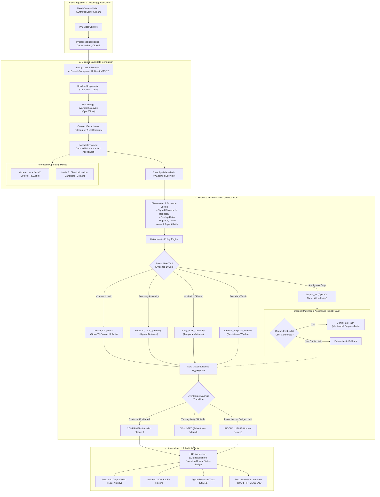
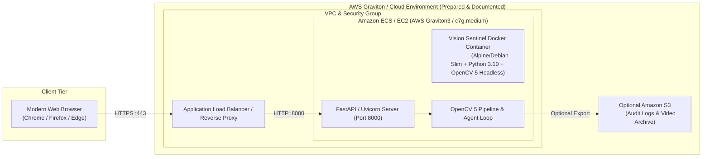

# Vision Sentinel — System Architecture

**OpenCV AI Competition 2026, powered by AWS**  
**Substantive Computer Vision with Genuine OpenCV 5 & Evidence-Driven Agentic Reasoning**

---

## 1. Architectural Philosophy & Core Tenets

Vision Sentinel is an evidence-driven, model-assisted restricted-zone entry verification tool. It is engineered specifically around fixed-camera surveillance verification where classical motion detectors suffer from high false-alarm rates due to noisy shadows, temporary occlusions, turning objects, and sensor artifacts.

The architecture strictly adheres to the following principles:
1. **Substantive Computer Vision**: OpenCV 5 (`5.0.0.93`) is the primary compute and perceptual foundation. All spatial, geometric, and temporal calculations are computed natively.
2. **Agentic Closed-Loop Reasoning**: Rather than acting as a static post-hoc explainer, the agent dynamically selects and executes OpenCV inspection tools based on accumulating visual evidence.
3. **Deterministic Local Reliability**: The system operates with 100% functionality out-of-the-box without requiring API keys, cloud services, or external model weights (Mode B fallback).
4. **Zero-Unauthorized-Spend Cloud Compliance**: Cloud artifacts are packaged cleanly (Docker, AWS ECS/Graviton deployment configs, minimal IAM) without spawning unauthorized paid infrastructure.
5. **Privacy by Design**: Real user media is never transmitted to cloud AI providers without explicit consent. When enabled, only tiny ambiguous image crops are evaluated.

---

## 2. End-to-End System Pipeline

---

## 3. Component Breakdown

### 3.1 Vision Subsystem (`app/vision/`)
- **`video_io.py`**: Robust frame reader handling MP4, AVI, WebM with frame-rate normalization, boundary clipping, and duration limits (up to 180s, 1920px max).
- **`preprocessing.py`**: Gaussian spatial filtering, CLAHE contrast adaptive histogram equalization, and normalized bounding-box crop extraction.
- **`motion.py`**: OpenCV 5 `BackgroundSubtractorMOG2` with dynamic shadow pixel suppression (thresholding > 250 to purge soft gray ground shadows), morphology operations (3x3 ellipse kernels), and contour property extraction (area, moments, centroids).
- **`zones.py`**: Polygon coordinate normalization, `cv2.pointPolygonTest` computing Euclidean signed distance to the boundary, polygon rasterization for bounding-box IoU overlap, and motion trajectory regression vectors.
- **`tracking.py`**: `CandidateTracker` maintaining persistent temporal tracks across missing/occluded frames using combined Euclidean centroid distance and bounding-box IoU association.
- **`detector.py`**: `LocalDetector` utilizing OpenCV 5 DNN (`cv2.dnn.readNetFromONNX`) with CPU backend. Operates in **Mode A** when `models/person_detector.onnx` is present, or defaults to **Mode B** (`moving_object_candidate`) when weights are omitted.
- **`annotation.py`**: Real-time Heads-Up Display (HUD) rendering semi-transparent polygon zones (`cv2.addWeighted`), object motion breadcrumbs, trajectory arrows, and color-coded state badges.

### 3.2 Agentic Decision Subsystem (`app/agent/`)
- **`registry.py`**: Central `ToolRegistry` enforcing typed Pydantic schemas for all tool arguments and outputs. Strict security guardrails prevent arbitrary code or shell execution.
- **`tools.py`**: OpenCV-backed inspection primitives:
  - `inspect_roi`: Computes Canny edge density and Laplacian blur variance on image crops.
  - `extract_foreground`: Analyzes contour solidity and aspect ratio.
  - `evaluate_zone_geometry`: Evaluates signed distance and trajectory heading relative to the polygon perimeter.
  - `verify_track_continuity`: Validates displacement smoothness and frame loss across a track's lifetime.
  - `recheck_temporal_window`: Verifies persistence thresholds over multi-frame sliding buffers.
  - `confirm_candidate`, `dismiss_candidate`, `mark_inconclusive`: Terminal state transition tools.
- **`policy.py`**: Evidence-driven deterministic decision engine evaluating incoming visual measurements against strict transition rules.
- **`orchestrator.py`**: Executes the iterative loop (`OBSERVE -> EVALUATE -> EXECUTE OPENCV TOOL -> UPDATE EVIDENCE -> DECIDE`), enforcing a maximum step budget (5 steps per candidate) to prevent execution cycles.
- **`trace.py`**: Structured JSONL logger recording timestamps, candidate IDs, visual evidence vectors, tool selections, tool outputs, and state transitions.

### 3.3 Optional Multimodal Reasoning (`app/providers/gemini.py`)
- **Isolation**: Cleanly separated adapter; missing API keys or disabled flags do not affect application startup or local agent functionality.
- **Privacy Gating**: Explicit consent flag (`GEMINI_SEND_USER_MEDIA=false`). Real user media is blocked from cloud transmission by default.
- **Strict Budgeting**: Hard cap of 3 API calls per analysis job to ensure zero unexpected quota usage.
- **Strict Schemas**: Model responses are validated via `GeminiSemanticEvaluation` Pydantic models. Unstructured free-text responses are rejected.
- **Deterministic Fallback**: Rate limits, timeouts, or API unavailability immediately trigger deterministic local policies without user-facing failure.

---

## 4. Cloud Deployment Architecture (AWS)

### Local Development vs. Verified Cloud Execution Matrix

| Architecture Dimension | Local Verified Development Path | Prepared AWS Cloud Path |
| :--- | :--- | :--- |
| **Compute Hardware** | Local AMD64 / ARM Host | AWS Graviton (Arm Neoverse) / EC2 |
| **Container Engine** | Multi-stage Dockerfile (`linux/amd64`, `linux/arm64`) | Amazon ECS or EKS |
| **Storage** | Local structured `./data/` directories | Ephemeral container volume + S3 export |
| **Inference** | CPU via `cv2.dnn.DNN_TARGET_CPU` | AWS Graviton NEON / Arm SIMD acceleration |
| **Zero-Cost Status** | **VERIFIED (Zero cloud spend)** | **PREPARED (Zero unauthorized charges created)** |

---

## 5. Security & Boundary Guardrails

1. **Path Traversal Protection**: All artifact download and file ingestion routes strictly enforce `Path.resolve()` checks within `settings.data_dir`. Attempts to access system files return HTTP 404.
2. **Resource Boundaries**:
   - Max file size: 100 MB.
   - Max video duration: 180 seconds.
   - Max frame dimension: 1920 pixels.
   - Concurrency limits and memory-safe generator-based frame processing.
3. **No Autonomous Actuation**: Vision Sentinel is an inspection and audit tool. It possesses no physical actuators, locks, relays, or emergency dispatch connections. All confirmed events require human sign-off.
